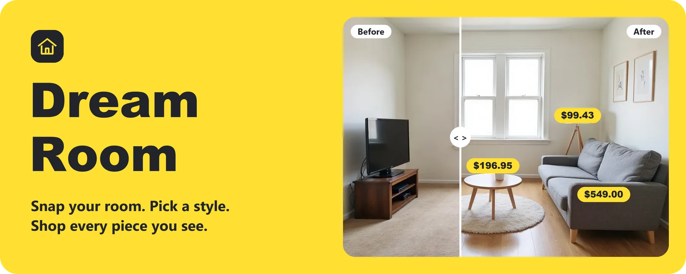
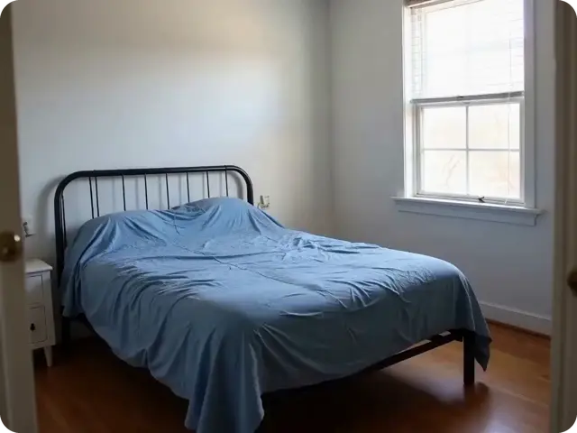
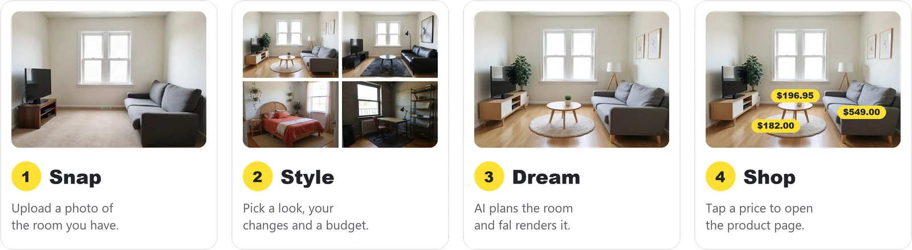
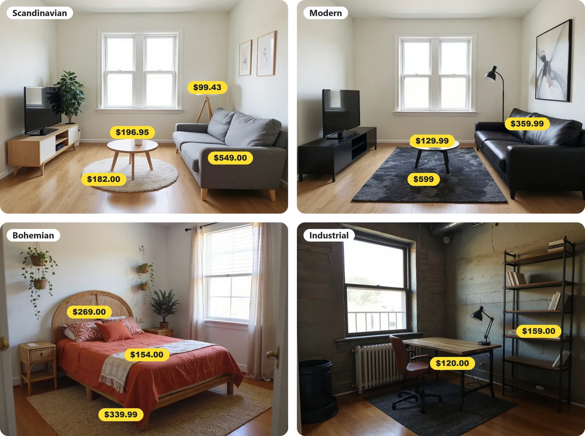
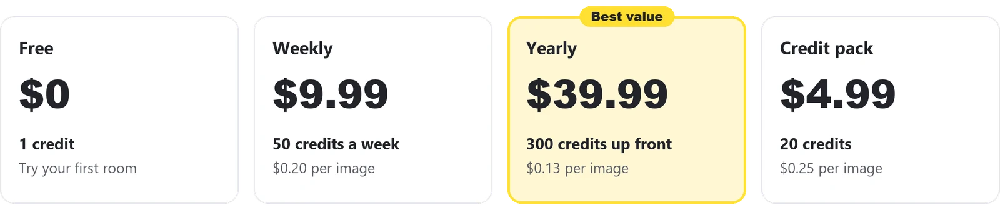

<p align="center">
  
</p>

<p align="center">
  
  
  
  
</p>

<h3 align="center">The room you have, turned into the room you want. 🏡✨</h3>

<p align="center">
  Upload a photo, choose a style and a budget, and watch your room change.<br>
  Every new piece comes with a real product, a real price and a link to the store.
</p>

<br>

## ✨ Watch a room transform

<p align="center">
  
</p>

<p align="center"><sub>A prepared example made with MiniMax H3 on fal. The live flow creates images.</sub></p>

## 🪄 How it works

<p align="center">
  
</p>

Not quite right? Ask for a change and the room updates, or get advice from the design chat. 💬

## 🎨 One room, your style

<p align="center">
  
</p>

## 💛 Plans

<p align="center">
  
</p>

Each generated image uses 1 credit. Payments run through RevenueCat Web Billing in sandbox mode, so no real money is charged.

## 🧰 Built with

| | Tool | What it does |
| :---: | --- | --- |
| 🧠 | **Gemini 2.5 Flash** on fal | Plans the room, searches for products, finds them in the image, powers the chat |
| 🖼️ | **FLUX Kontext** on fal | Redesigns the room photo |
| 🎬 | **MiniMax H3** on fal | Made the home page video ahead of time |
| 💳 | **RevenueCat** with Stripe sandbox | Plans, credits and checkout |
| ☁️ | **Cloudflare Workers** | Routing and the API |
| 🍦 | **Plain JavaScript** | The whole front end, with no build step |

## 🚀 Run it locally

You need Node.js and a [fal API key](https://fal.ai/dashboard/keys).

**1.** Create a `.dev.vars` file in the project root. Git ignores this file.

```
FAL_KEY=your_key_here
```

**2.** Start the server.

```sh
npx wrangler dev
```

**3.** Open http://localhost:8787. First-time visitors go through onboarding, then land in the app.

> [!TIP]
> To test a payment, use the Stripe test card `4242 4242 4242 4242` with any future expiry date and any CVC.

> [!IMPORTANT]
> `FAL_KEY` stays on the server. The key in `public/app/config.js` is RevenueCat's public sandbox key, which is meant to run in the browser. Never put a secret key in `public/`.

## 🗂️ Project map

```
public/app/          Home, Create, Result, Designs, Chat and Settings
public/onboarding/   First-visit flow and paywall
public/assets/       Shared images and the home page video
public/styles.css    Shared styles
room-api.mjs         API routes: plan, products, render, chat
worker.mjs           Routing for the Cloudflare Worker
scripts/             Image generation for the example rooms
docs/                Design template, team plan and pitch outline
```

To deploy, run `npx wrangler deploy` with access to the Cloudflare account for `getwaia.com`.

## 🌱 What comes next

- [ ] Move credit and plan checks to the server, they run in the browser today
- [ ] Verify product links and prices, they come from a web search and can go out of date
- [ ] Place the exact product in the room, rendered pieces look similar but are not exact copies
- [ ] Offer video reveals in the live flow
- [ ] Add store affiliate links

<br>

<p align="center">
  Built in one day at the <b>RevenueCat x Third Room x fal x Neon Apps AI Hackathon</b>, November 2026 💛<br>
  <sub>More project notes in <a href="HANDOFF.md">HANDOFF.md</a></sub>
</p>
